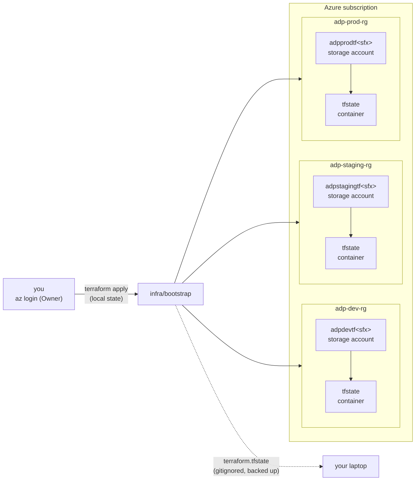
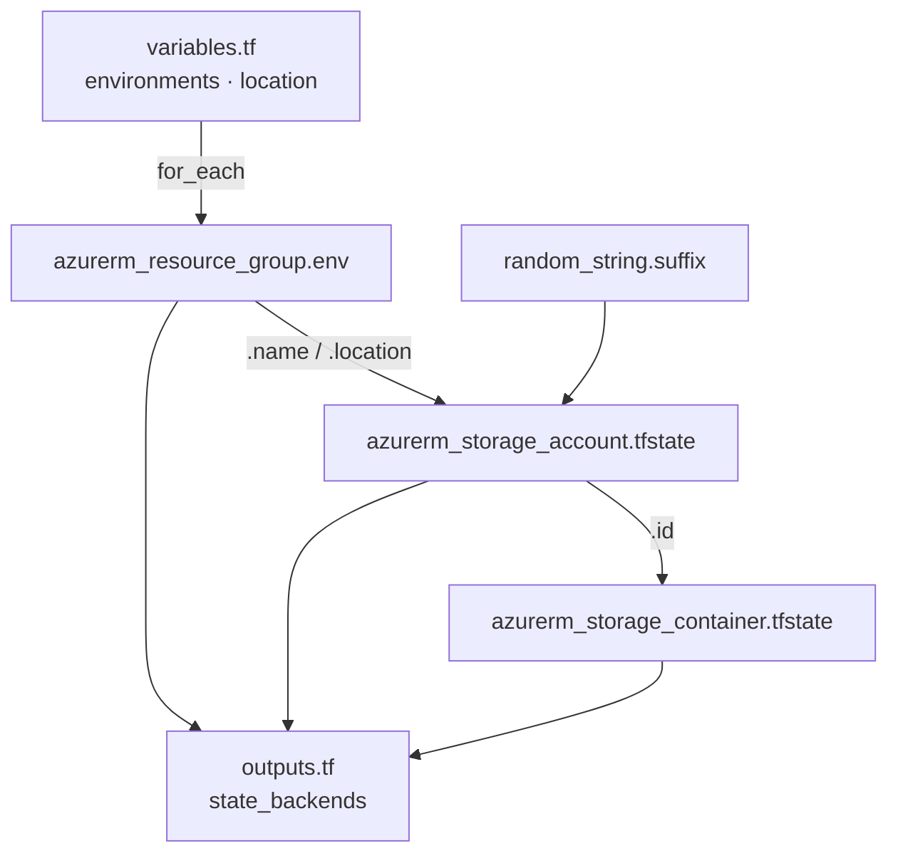
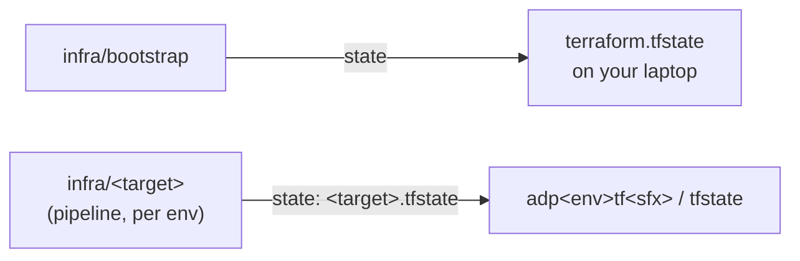

# Bootstrap

What `infra/bootstrap/` creates, and why it runs by hand. Bootstrap creates what the pipeline needs before it can run: somewhere to store Terraform state now, and identities and role assignments later.



## Resources

`terraform plan` should show **10 to add**. Everything is in `eastus` and tagged `project`, `managed_by`, `env`.

| Terraform address | Azure resource | Name |
|---|---|---|
| `random_string.suffix` | none (state only) | 6 lowercase alphanumeric chars, shared by all envs |
| `azurerm_resource_group.env[<env>]` | Resource group | `adp-<env>-rg` |
| `azurerm_storage_account.tfstate[<env>]` | Storage account | `adp<env>tf<sfx>` |
| `azurerm_storage_container.tfstate[<env>]` | Blob container | `tfstate` |

`<env>` is `dev`, `staging`, `prod` (`var.environments`, iterated with `for_each`).

**Each storage account:** Standard / LRS (cheapest), shared key access **disabled** (Entra ID only), public blob access disabled, TLS 1.2 minimum, blob **versioning on** so a corrupted state file can be rolled back.

## How the files connect



| File | Holds |
|---|---|
| `versions.tf` | Terraform and provider version constraints. **No `backend` block**, so state is local. |
| `providers.tf` | `azurerm` with `storage_use_azuread = true` (keys are disabled). Subscription comes from `ARM_SUBSCRIPTION_ID`. |
| `variables.tf` | Environment list and region. |
| `main.tf` | The resources above. |
| `outputs.tf` | `state_backends`: per-env RG, account and container, the values each target passes with `-backend-config`. |
| `.terraform.lock.hcl` | Exact provider versions and checksums. Committed. |

## Where state lives



- **Bootstrap state is local.** Bootstrap creates the remote backend, so it can't store its state there on the first run. Local state is fine here because there's one operator, it changes rarely, and the resources can be brought back with `import` blocks. In a team it would move to a separately governed storage account. Back up the file: if it's lost, the next apply generates a new suffix and tries to create new storage accounts.
- **Target state is remote,** one file per target in that env's container, accessed with Entra ID (`use_azuread_auth = true`).

## Why one storage account per env

Contributor on a resource group can list a storage account's keys, and a key gives access to **every** container in the account, whatever container-level RBAC says. So only separate accounts, each in its own env's RG, guarantee the dev identity can't read or overwrite prod state. Deleting the account, firewall rules and data-protection settings are also per account, so a dev change can't affect prod.

## Run it

From `infra/bootstrap/`, logged in with `az login`:

```sh
export ARM_SUBSCRIPTION_ID=$(az account show --query id -o tsv)
terraform init
terraform plan -out=bootstrap.tfplan    # expect 10 to add
terraform apply bootstrap.tfplan
terraform output state_backends
```

## Not yet

Entra app registrations, federated credentials (`environment:<env>`), role assignments (Contributor on the env RG, Storage Blob Data Contributor on the env's `tfstate` container), delete locks on the state accounts.
