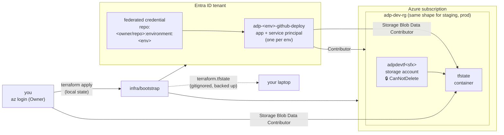
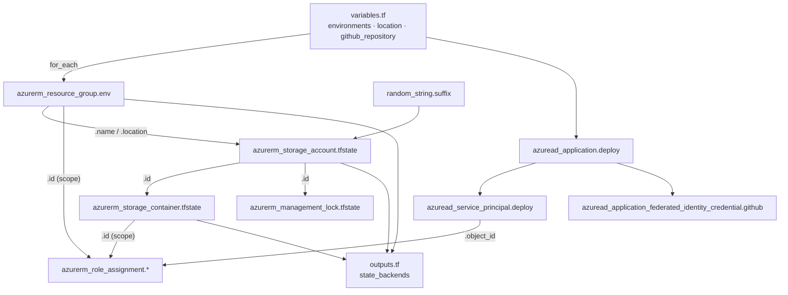
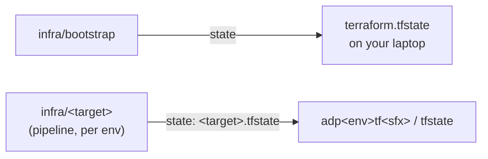

# Bootstrap

What `infra/bootstrap/` creates, and why it runs by hand. Bootstrap creates what the pipeline needs before it can run: somewhere to store Terraform state, an identity per env for GitHub Actions to log in as, and the role assignments that limit each identity to its own env.



## Resources

A fresh `terraform plan` shows **31 to add**. Azure resources are in `eastus` and tagged `project`, `managed_by`, `env`; Entra objects are tenant-wide (no region, no RG).

| Terraform address | Creates | Name / scope |
|---|---|---|
| `random_string.suffix` | none (state only) | 6 lowercase alphanumeric chars, shared by all envs |
| `azurerm_resource_group.env[<env>]` | Resource group | `adp-<env>-rg` |
| `azurerm_storage_account.tfstate[<env>]` | Storage account | `adp<env>tf<sfx>` |
| `azurerm_storage_container.tfstate[<env>]` | Blob container | `tfstate` |
| `azurerm_management_lock.tfstate[<env>]` | Delete lock | `tfstate-lock` on the storage account |
| `azuread_application.deploy[<env>]` | App registration | `adp-<env>-github-deploy` |
| `azuread_service_principal.deploy[<env>]` | Service principal | the app's instance in this tenant |
| `azuread_application_federated_identity_credential.github[<env>]` | Federated credential | subject `repo:<owner/repo>:environment:<env>` |
| `azurerm_role_assignment.deploy_rg_contributor[<env>]` | Role assignment | deploy SP → **Contributor** on `adp-<env>-rg` |
| `azurerm_role_assignment.deploy_tfstate_blob[<env>]` | Role assignment | deploy SP → **Storage Blob Data Contributor** on that env's `tfstate` container |
| `azurerm_role_assignment.operator_tfstate_blob[<env>]` | Role assignment | you → **Storage Blob Data Contributor** on that env's `tfstate` container |

`<env>` is `dev`, `staging`, `prod` (`var.environments`, iterated with `for_each`).

**Each storage account:** Standard / LRS (cheapest), shared key access **disabled** (Entra ID only), public blob access disabled, TLS 1.2 minimum, blob **versioning on** so a corrupted state file can be rolled back.

## How GitHub Actions gets in (OIDC)

No client secret exists anywhere. A job running in GitHub environment `<env>` asks GitHub for an OIDC token whose subject is `repo:<owner/repo>:environment:<env>`. Entra accepts it only for the app whose federated credential matches that subject exactly, and issues an Azure token for that app's service principal.

So the **GitHub environment is the gate**: its protection rules (deployment branch policy, prod approval) decide which jobs can get a token, and the token's roles only reach that env's RG and state container.

## Who can do what

| Identity | Control plane | State (data plane) |
|---|---|---|
| `adp-<env>-github-deploy` | Contributor on its own RG only. Can't create role assignments, register providers, or remove locks. | Read/write its own env's `tfstate` container only. |
| You (operator) | Owner on the subscription (needed to create role assignments). | Read/write every env's `tfstate` container (standing, for recovery). Owner alone doesn't grant blob access. |

## How the files connect



| File | Holds |
|---|---|
| `versions.tf` | Terraform and provider version constraints (`azurerm`, `azuread`, `random`). **No `backend` block**, so state is local. |
| `providers.tf` | `azurerm` with `storage_use_azuread = true` (keys are disabled); subscription from `ARM_SUBSCRIPTION_ID`. `azuread` with tenant and credentials from `az login`. |
| `variables.tf` | Environment list, region, GitHub repo (`owner/name`). |
| `main.tf` | Resource groups, state storage, delete locks. |
| `identity.tf` | Entra side: app registrations, service principals, federated credentials. |
| `rbac.tf` | Role assignments for the deploy SPs and the operator. |
| `outputs.tf` | `state_backends`: per-env RG, account and container, the values each target passes with `-backend-config`. |
| `.terraform.lock.hcl` | Exact provider versions and checksums. Committed. |

## Where state lives



- **Bootstrap state is local.** Bootstrap creates the remote backend, so it can't store its state there on the first run. Local state is fine here because there's one operator, it changes rarely, and the resources can be brought back with `import` blocks. In a team it would move to a separately governed storage account. Back up the file after every apply: if it's lost, the next apply generates a new suffix and tries to create new storage accounts and duplicate app registrations.
- **Target state is remote,** one file per target in that env's container, accessed with Entra ID (`use_azuread_auth = true`).

## Why one storage account per env

Contributor on a resource group can list a storage account's keys, and a key gives access to **every** container in the account, whatever container-level RBAC says. So only separate accounts, each in its own env's RG, guarantee the dev identity can't read or overwrite prod state. Deleting the account, firewall rules and data-protection settings are also per account, so a dev change can't affect prod.

## What the delete lock does (and doesn't)

- **Blocks** deleting the state account, and therefore deleting its RG (Azure refuses to delete an RG containing a locked resource).
- **Can't be removed by the pipeline:** deleting a lock needs `Microsoft.Authorization/locks/delete`, which Contributor lacks.
- **Doesn't protect blobs:** locks are control plane only. Overwriting or deleting the state file is covered by blob versioning.

## Run it

From `infra/bootstrap/`, logged in with `az login` as a subscription Owner:

```sh
export ARM_SUBSCRIPTION_ID=$(az account show --query id -o tsv)
terraform init
terraform plan -out=tfplan    # fresh: expect 31 to add
terraform apply tfplan
terraform output state_backends
```

Then back up `terraform.tfstate` outside the repo.

## Tearing down

The locks block `terraform destroy` (and deleting the RGs). Remove the `azurerm_management_lock` resource from `main.tf` and apply first, then destroy. Destroying also removes the Entra apps; deleting an RG by hand would not.

## Not yet

- Register resource providers each target needs (`azurerm_resource_provider_registration`), e.g. `Microsoft.Web` for v1. The deploy identities can't register them.
- Output each env's deploy `client_id` (plus tenant and subscription IDs) for the GitHub environment variables `azure/login` needs.
