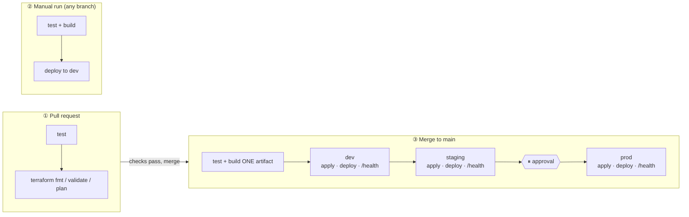
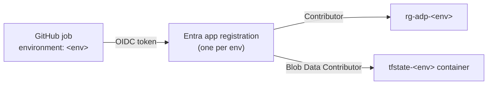

# Deployment pipeline

How a change gets from a branch to production. Each target (`appservice`, `containerapps`, `functions`) has its own workflow with this same shape.

## Triggers

| Trigger | Runs | Changes Azure? |
|---|---|---|
| ① PR to `main` | test, `terraform fmt/validate/plan` | No |
| ② Manual (`workflow_dispatch`) | test, build, deploy a chosen branch to **dev** | dev only |
| ③ Push to `main` (merge) | build once → dev → staging → ⏸ → prod | Yes |

## Environments

| Env | Accepts | Purpose |
|---|---|---|
| `dev` | any branch (manual) + `main` | Playground. Proves it deploys. May be "dirty" until the next merge resets it. |
| `staging` | `main` only | Prod-like rehearsal. The real gate. |
| `prod` | `main` only, after approval | Live. |

Each env deploys the **same artifact** built at the start of run ③, and stops the run if `/health` fails. dev → staging is automatic; the prod approval is the only manual gate.

## Inside an environment job

Every env job (dev, staging, prod) applies its own infrastructure and then deploys the app, in this order:

1. **Log in:** OIDC → that env's identity (`azure/login`, `ARM_USE_OIDC=true` for Terraform).
2. **`terraform init`:** `-backend-config` points at `tfstate-<env>`, key `<target>.tfstate`. The backend uses `use_azuread_auth = true`, because access is through Entra ID roles, not storage keys.
3. **`terraform plan -var-file=<env>.tfvars -out=tfplan`**
4. **`terraform apply tfplan`:** updates that env's resources and state.
5. **`terraform output`:** gets the app name and URL for the next steps.
6. **Deploy** the artifact, then **`/health`** check.

Infrastructure is applied before the app is deployed, so a PR that changes both ships them together.

## Isolation

- **No secrets in GitHub:** jobs authenticate through OIDC federated credentials, scoped to `environment:<env>`.
- **Each identity can only touch its own environment:** its resource group and its state container.
- **Deployment branch policy:** `staging` and `prod` only accept runs from `main`, so a manual branch run can't reach them.
- **`concurrency` group per environment:** runs queue instead of deploying over each other.

## When things fail

| Failure | Result | Recovery |
|---|---|---|
| PR checks fail | Can't merge | Fix on the branch |
| dev / staging fails after merge | Run stops; prod untouched | Fix forward with a new PR, or revert |
| prod `/health` fails | Prod broken | App: redeploy the previous artifact. Infra: revert the PR. |

No manual changes in the portal. Every fix goes through this pipeline.
